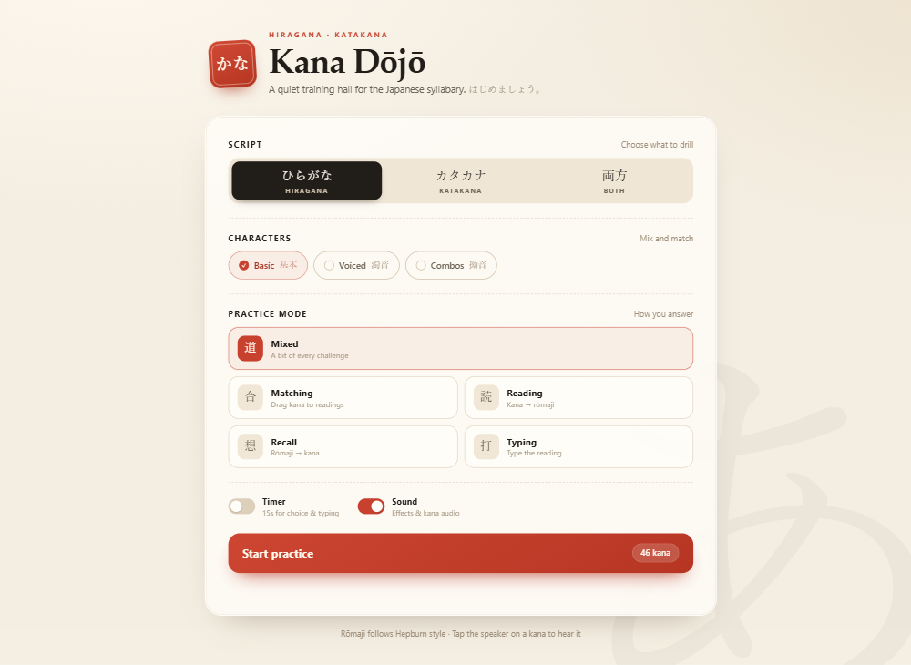

# Kana Dōjō

A level-based Japanese learning game that takes a complete beginner from zero kana to reading
vocabulary and building first sentences.

This project began life as a single-file kana quiz (preserved at
[`legacy/kana-dojo-legacy.html`](legacy/kana-dojo-legacy.html) as a working reference). It is
being rebuilt as a React + TypeScript application with a campaign structure, lesson phases,
spiral review, and three additional grammar exercise engines.



## Project status

**Phase 2 of 4 — curriculum authored, awaiting Checkpoint 1 review.** The Vite + React +
TypeScript foundation is in place, the original design system has been ported to
`src/styles/global.css`, and the full kana curriculum plus the first vocabulary and grammar blocks
are generated. The dev build includes a curriculum-review screen for sign-off.

## Quick start

Requires Node.js 20+.

```bash
npm install
npm run dev        # http://localhost:5173
```

Other scripts:

```bash
npm run build        # typecheck + production build into dist/
npm run preview      # serve the production build locally
npm run typecheck    # tsc -b only
npm run lint         # oxlint
npm run data:convert # regenerate enriched vocab/kanji data from curated + datasets
```

## Deploy

The app is a static Vite site; **Vercel is the primary target** (zero-config, connect the repo and
deploy). GitHub Pages is also supported with a build workflow. See
[`docs/DEPLOYMENT.md`](docs/DEPLOYMENT.md) for exact steps, including the SPA rewrite rule.

## How the game works

- **Campaign path.** Levels unlock sequentially after scoring at least 80% on the previous level.
- **Learn first, then drill.** Each level opens with lesson cards for its new items, then quizzes them.
- **Kanji through vocabulary.** Kanji are introduced inside words (水 → みず), never as isolated
  symbol/reading pairs, so typing answers stay unambiguous.
- **Spiral review.** Later levels draw roughly 25% of their questions from items the learner has
  previously missed, weighted by miss count.
- **Free practice.** The original Dojo settings screen survives as an unlocked practice mode.
- **Local progress.** Levels, miss weights, and best scores live in `localStorage`; there are no
  accounts or servers.

The full mechanics, schemas, and engine design are in
[`docs/ARCHITECTURE.md`](docs/ARCHITECTURE.md).

## Roadmap

| Phase | Scope |
| --- | --- |
| **1 — Scaffold** ✅ | Vite + React + TS, design system migration, docs, Vercel config |
| **2 — Content pipeline** 🟡 | Curated curriculum, enrichment script, attribution, content review checkpoint |
| **3 — Engines** | Progress store, question builder, lesson phase, five quiz engines, grammar review checkpoint |
| **4 — Vertical slice** | Level map, end-to-end flow, on-miss mnemonics, free-practice Dojo, polish |

The vertical slice covers full kana (hiragana then katakana by gojūon row), a first
kanji-in-vocabulary block, and one grammar level combining particle fill-in with word-order
assembly.

## Content and licensing

Vocabulary and kanji data will be enriched from **JMdict** and **KANJIDIC2** (CC BY-SA 3.0,
© Electronic Dictionary Research and Development Group) and example sentences from **Tatoeba**
(CC BY 2.0 FR). Attribution is rendered in the app footer and documented in
[`THIRD_PARTY_LICENSES.md`](THIRD_PARTY_LICENSES.md).

The game's own source code currently has no license (all rights reserved) unless one is added.

## Documentation

| Document | Purpose |
| --- | --- |
| [`docs/ARCHITECTURE.md`](docs/ARCHITECTURE.md) | Stack, data model, engines, progress and locking design |
| [`docs/DATA-PIPELINE.md`](docs/DATA-PIPELINE.md) | Curriculum authoring, dataset conversion, licences |
| [`docs/DEPLOYMENT.md`](docs/DEPLOYMENT.md) | Vercel and GitHub Pages deployment |
| [`docs/DECISIONS.md`](docs/DECISIONS.md) | Decision log from the design interview |
| [`docs/SESSION-2026-10-21.md`](docs/SESSION-2026-10-21.md) | Session handoff: work completed, checkpoint items, next steps |
| [`AGENTS.md`](AGENTS.md) | Project conventions for contributors and coding agents |
