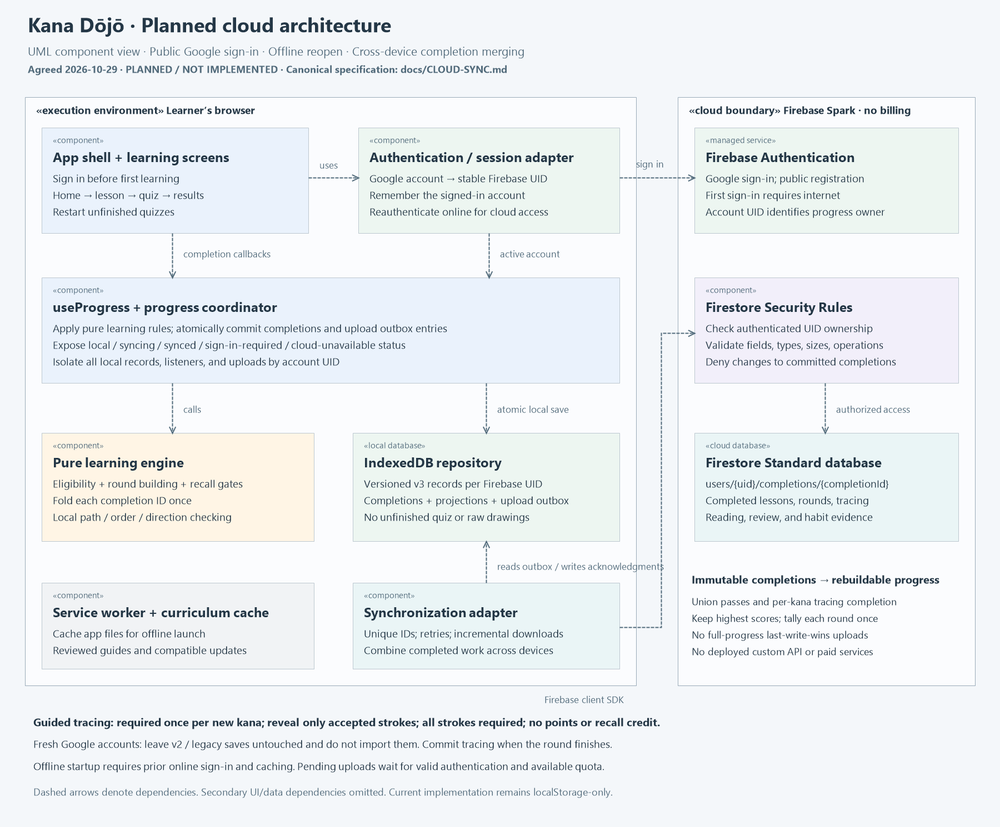
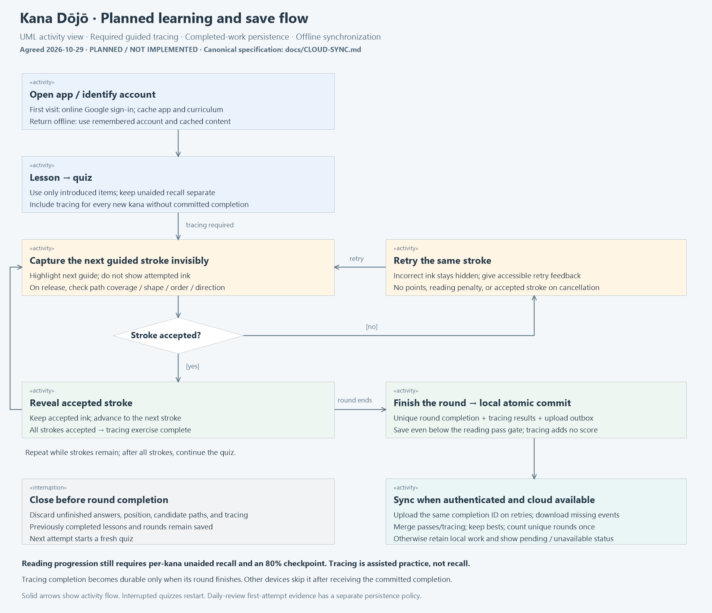

# Architecture diagrams

Updated **2026-10-29** after the cloud/offline/tracing design interview. Diagrams describe either
the source baseline or the agreed target, explicitly labeled. Planned features are not built.

| View | PNG image | Editable vector |
| --- | --- | --- |
| Implemented Phase 3 baseline | [Current architecture](current-architecture.png) | [SVG](current-architecture.svg) |
| Planned cloud and offline components | [Cloud architecture](planned-cloud-architecture.png) | [SVG](planned-cloud-architecture.svg) |
| Planned tracing, quiz restart, and save flow | [Learning flow](planned-learning-flow.png) | [SVG](planned-learning-flow.svg) |





The baseline remains React + localStorage with no sign-in/backend/service worker/tracing. It is
evidence of the existing code, not an instruction to keep account-free storage. The target uses
public Google sign-in, Spark Firestore without billing, account-scoped IndexedDB, service-worker
caching, merged completed work, and required once-per-kana tracing. Old browser saves are not
imported. See [CLOUD-SYNC.md](../CLOUD-SYNC.md) for contracts and unresolved implementation details.

Regenerate planned SVGs and all PNGs from the repository root on Windows:

```powershell
node scripts/generate-architecture-diagrams.cjs
```

The renderer uses Node and Windows PowerShell/System.Drawing; no paid service, network request,
image-generation API, or additional npm dependency is needed. Planned diagram layout/content lives
in that script. The existing baseline SVG is its own editable source; PNG exports follow it.
